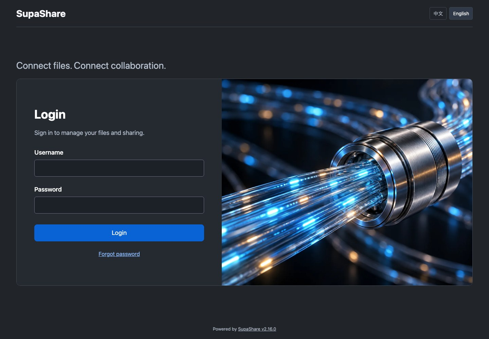
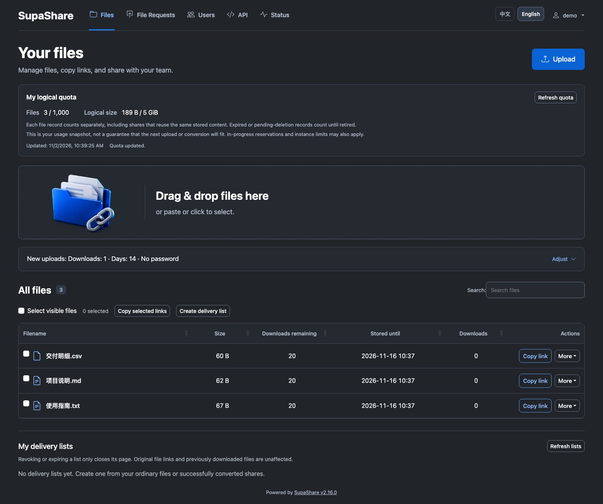
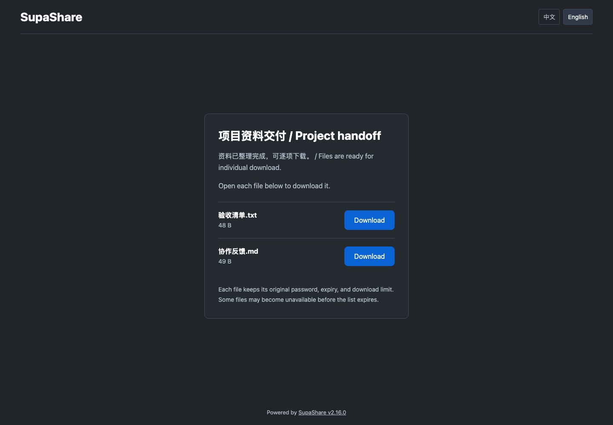
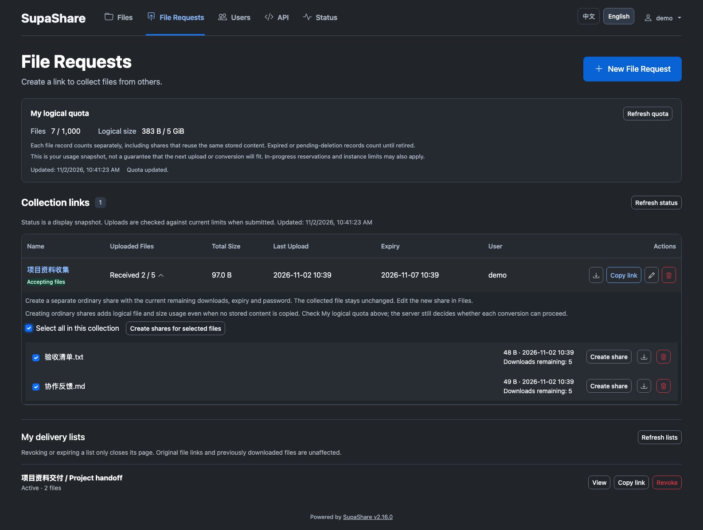

# SupaShare

[简体中文](README.md) · **English**


**Self-hosted file collection and delivery for individuals and small teams.**

Keep files in storage you control and connect your team and collaborators with a link.
Passwords, expiry dates and download limits help you control access for safer sharing.
Start sharing quickly, let contributors submit through a collection link without an account,
and deliver multiple files through one list with individual downloads for a convenient handoff.
English and Simplified Chinese are built in.

**Version 2.16.0** · Linux **amd64/arm64** server binaries and checksums:
[Releases](https://github.com/Activer007/SupaShare/releases).
Docker deployments build the image from this repository.

[Quick start](#quick-start) · [Screenshots](#screenshots) · [Documentation](#documentation)

## Highlights

| Feature | What it provides |
| --- | --- |
| Ordinary shares | Share files with optional passwords, expiry dates and download limits. |
| File collection | Account-free submission links, intake deadlines and per-file download allowances. |
| Collect → share → deliver | Convert selected submissions into ordinary shares, then select 2–20 shares for one public delivery list. |
| Multi-select and copy | Select files for batch conversion or copy filenames and share links together. |
| Original download rules | Each delivery item keeps its password, expiry and download-count rules. Files download individually. |
| Intake status and arrivals | See received files, occupied slots and expiry; get new-arrival notices on the current management page (60-second visible-page checks and a check on returning to the tab). |
| Personal logical quota | Read the server’s authoritative count and logical byte usage for your own files against the effective user limits. Multiple shares of the same content count separately. |
| Bilingual administration | Manage accounts, scoped API credentials, links and site identity in English or Simplified Chinese. |

Revoking a delivery list closes that list's URL. Separately copied file links retain
their own validity. Quota figures describe retained file records, including expired
or pending-deletion records, and do not guarantee admission for another upload.
Local storage, S3-compatible storage, REST API/CLI and OpenID Connect are supported;
see the guides for encryption and configuration choices.

## Quick start

For a new installation, install Git and Docker with Compose, then run:

```bash
git clone https://github.com/Activer007/SupaShare.git
cd SupaShare
cp .env.dist .env
docker compose up -d --build
docker compose logs --tail=80 supashare
```

Compose builds `supashare:local`, binds `127.0.0.1:53842`, and stores files in
`./gokapi-data` and configuration in `./gokapi-config`.

1. Find the **setup credential file path** printed in the startup log; the password itself is not logged.
2. Replace `<printed-path>` with that exact path and read the file:

   ```bash
   docker compose exec supashare cat '<printed-path>'
   ```

3. Open [http://127.0.0.1:53842/setup](http://127.0.0.1:53842/setup) in a desktop browser.
   Sign in as `setup` with the file's password and finish the wizard to create your administrator account.

For a remote host, run Compose there and open an SSH tunnel from your computer:

```bash
ssh -N -L 53842:127.0.0.1:53842 user@your-server
```

Then visit the same local setup URL. Use HTTPS for public access and set the public
server URL to the address users will visit. Native installation, proxy settings and
the optional non-root Compose deployment are in the [setup guide](docs/setup.rst).

**Upgrading or migrating?** Follow [update and recovery](docs/update.rst) and the
[Gokapi migration notes](docs/repository-identity.rst). Stop the old service before
reusing its data, and retain consistent backups of data, database, configuration
and encryption keys.

## Screenshots

Real desktop screenshots from the **current 2.16.0 development checkout**, captured on 2026-11-02
using an isolated local instance and synthetic example data. See [image sources and maintenance](docs/images/README.md).

**Login**: each page load selects a local illustration, which stays fixed while signing in.



**File workspace**: inspect personal logical usage, upload rules and files; select shares to copy links or create a delivery list.



**Public delivery list**: recipients download files individually from one page, with each share's original rules.



<details>
<summary>File collection and batch conversion to shares</summary>

Inspect intake status, select received files and convert them to ordinary shares for delivery.



</details>

## Deployment notes

- Desktop browsers are the intended interface; common phone/tablet User-Agents receive HTTP 403. API/CLI clients remain supported.
- Deploy one server process for an individual or trusted small team. Multi-instance and HA deployments are outside this scope.
- `GOKAPI_*` variables and existing data/configuration directory names remain for compatibility. Upstream Gokapi images do not contain SupaShare changes.
- Delivery lists exclude E2E files. Encrypted downloads over HTTP still use the inherited external helper; see [identity and compatibility](docs/repository-identity.rst).

## Documentation

[Installation](docs/setup.rst) · [Usage and accounts](docs/usage.rst) ·
[File collections and arrivals](docs/file-collections.rst) · [Delivery lists](docs/delivery-lists.rst) ·
[Configuration and quotas](docs/advanced.rst) · [Updates](docs/update.rst) ·
[Troubleshooting](docs/troubleshooting.rst) · [Changelog](docs/changelog.rst) ·
[Contributing](CONTRIBUTING.md) · [Local development](docs/contributions.rst)

Report reproducible problems through [Issues](https://github.com/Activer007/SupaShare/issues).
For vulnerabilities, use the private reporting route in [SECURITY.md](SECURITY.md).

## Origin and license

Independently maintained by Activer007, SupaShare builds on **Gokapi**, created by
**Marc Ole Bulling**, and its contributors. The project retains the
[GNU AGPL v3 license](LICENSE.md). Its independent version line starts at `2.10.0`;
that does not imply releases 2.3–2.9 were published by this project.
