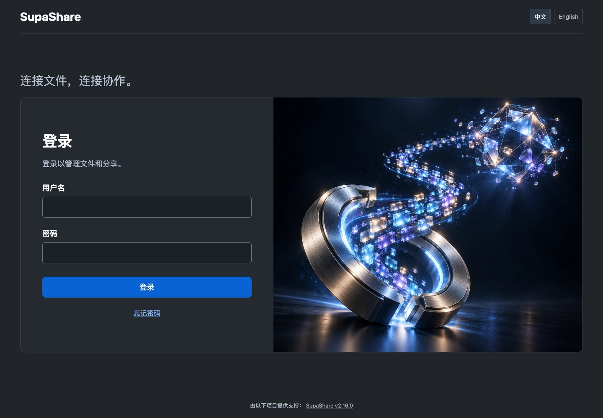
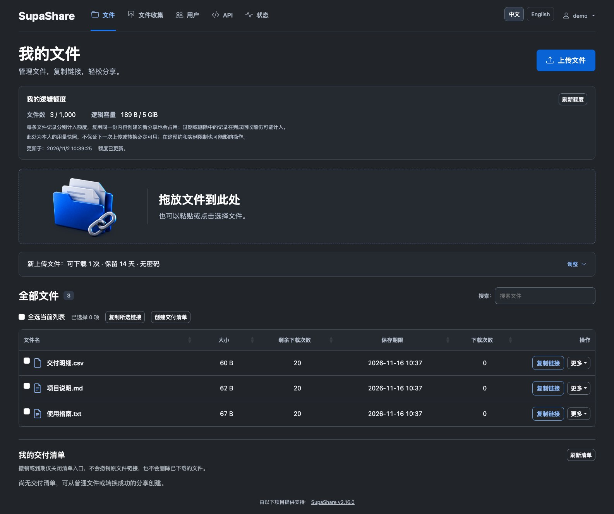
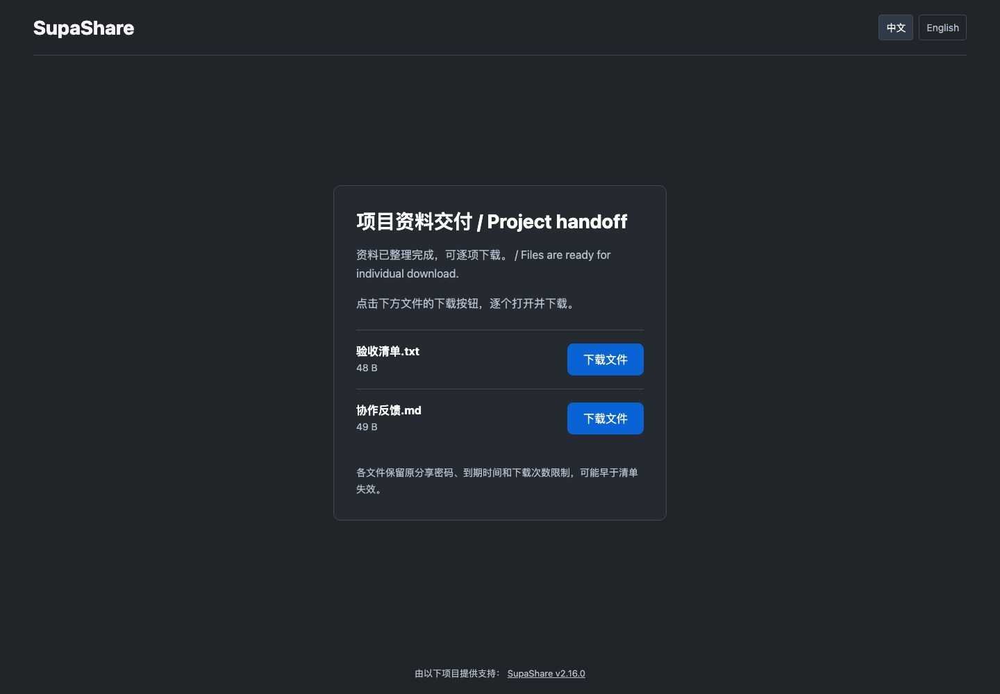
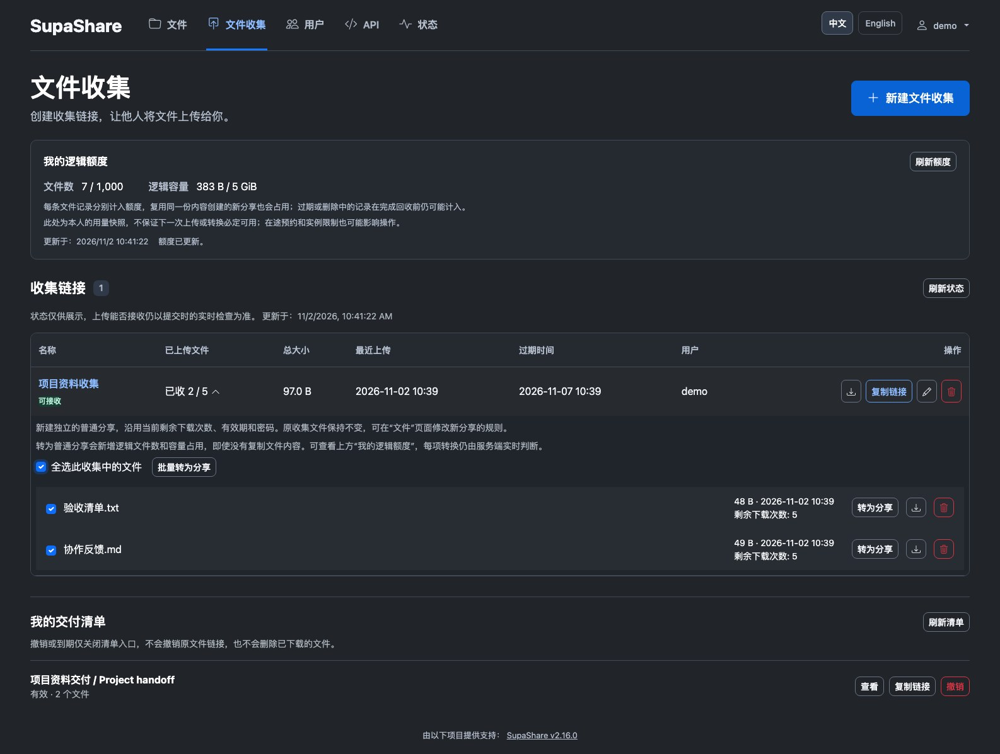

# SupaShare

**简体中文** · [English](README.en.md)


**面向个人与小团队的自托管文件收集与交付应用。**

把文件放在自己掌控的存储里，用一条链接连接团队与协作者。用密码、有效期和下载次数控制访问，兼顾分享安全；
快速发起分享，协作者无需注册即可通过收集链接提交文件，再用一条清单链接逐项交付，让收集与交接更便捷。
应用内置简体中文与英文界面。

**版本 2.16.0** · Linux **amd64/arm64** 服务端二进制与校验文件：
[Releases](https://github.com/Activer007/SupaShare/releases)。Docker 部署使用本仓库源码构建镜像。

[快速开始](#快速开始) · [界面截图](#界面截图) · [文档导航](#文档导航)

## 主要功能

| 功能 | 使用方式 |
| --- | --- |
| 普通文件分享 | 为文件设置可选密码、有效期和下载次数。 |
| 文件收集 | 创建无需账户的提交链接，设置收件截止时间和每个文件的下载次数。 |
| 收集 → 分享 → 交付 | 将选中的收件转为普通分享，再选择 2～20 项生成一条公开交付清单链接。 |
| 多选与批量复制 | 多选文件批量转换，或将文件名和分享链接一起复制。 |
| 保留原下载规则 | 接收人在清单页面逐项下载，各文件继续使用原有密码、有效期与下载次数。 |
| 收件状态与新到提醒 | 区分已收文件、占用名额和到期状态；仅当前管理页面提醒；可见时每 60 秒检查，返回标签页时补查。 |
| 本人逻辑额度 | 查看服务端权威统计的本人逻辑文件数、容量及当前有效上限；同一内容创建多个分享会分别计量。 |
| 中英文管理界面 | 管理账户、API 密钥权限、链接和站点名称，支持切换简体中文与英文。 |

撤销清单后，清单链接失效；已单独复制的文件链接仍按各自规则生效。
额度按尚未退休的文件记录计算，包含过期或待删除记录；当前数字不保证下一次上传一定通过。
支持本地和 S3 兼容存储、REST API/CLI 及 OpenID Connect；加密与配置选项详见文档。

## 快速开始

以下用于全新安装。安装 Git 和支持 Compose 的 Docker 后运行：

```bash
git clone https://github.com/Activer007/SupaShare.git
cd SupaShare
cp .env.dist .env
docker compose up -d --build
docker compose logs --tail=80 supashare
```

Compose 会构建 `supashare:local`，将端口绑定到 `127.0.0.1:53842`，
文件保存在 `./gokapi-data`，配置保存在 `./gokapi-config`。

1. 从启动日志找到**安装凭据文件的路径**；日志不会输出密码本身。
2. 将 `<printed-path>` 替换为该完整路径，读取文件：

   ```bash
   docker compose exec supashare cat '<printed-path>'
   ```

3. 用电脑浏览器打开 [http://127.0.0.1:53842/setup](http://127.0.0.1:53842/setup)，
   以用户名 `setup` 和文件中的密码登录，完成向导并创建管理员账户。

远程部署时，在服务器运行 Compose，再从自己的电脑建立 SSH 隧道：

```bash
ssh -N -L 53842:127.0.0.1:53842 user@your-server
```

随后访问同一个本地安装地址。对外访问请使用 HTTPS，并将公开服务地址设为用户实际访问的地址。
本机安装、代理配置和可选的非 root Compose 部署见[安装指南](docs/setup.rst)。

**升级或迁移已有部署？** 请先阅读[更新与恢复](docs/update.rst)及
[Gokapi 迁移说明](docs/repository-identity.rst)。复用数据前停止旧服务，
并保留数据、数据库、配置与加密密钥的一致备份。

## 界面截图

以下为 **2.16.0 当前开发版本**的真实桌面截图，拍摄于 2026-11-02，使用本地隔离实例和合成演示数据。
[截图来源与维护说明](docs/images/README.md)。

**登录页面**：每次打开页面随机展示一张本地图集插图，登录操作期间保持不变。



**文件工作台**：查看本人逻辑额度、上传规则和文件列表，多选复制链接或创建交付清单。



**公开交付清单**：接收人通过一个页面逐项下载，每项继续使用原有分享规则。



<details>
<summary>文件收集与批量转为分享</summary>

查看收件状态，选中收到的文件批量转为普通分享，再继续交付。



</details>

## 部署与兼容性

- 面向桌面浏览器；常见手机和平板 User-Agent 会收到 HTTP 403。API/CLI 客户端仍可使用。
- 面向个人与可信小团队的单进程部署，多实例与高可用部署不在此范围。
- 保留 `GOKAPI_*` 环境变量及既有数据、配置目录名称。上游 Gokapi 镜像不包含 SupaShare 的改动。
- 交付清单暂不接受 E2E 文件。HTTP 加密下载仍依赖继承的外部辅助页，详见[项目标识与兼容性](docs/repository-identity.rst)。

## 文档导航

[安装指南](docs/setup.rst) · [使用与账户](docs/usage.rst) ·
[文件收集与新到提醒](docs/file-collections.rst) · [交付清单](docs/delivery-lists.rst) ·
[配置与逻辑额度](docs/advanced.rst) · [更新与恢复](docs/update.rst) ·
[问题排查](docs/troubleshooting.rst) · [变更记录](docs/changelog.rst) ·
[贡献说明](CONTRIBUTING.md) · [本地开发](docs/contributions.rst)

可复现的问题请提交到 [Issues](https://github.com/Activer007/SupaShare/issues)；
安全问题请使用 [SECURITY.md](SECURITY.md) 中的私密报告渠道。部分详细文档目前为英文。

## 项目来源与许可证

SupaShare 由 Activer007 独立维护，基于 **Marc Ole Bulling** 创建的 **Gokapi**
及其贡献者的工作发展，保留 [GNU AGPL v3 许可证](LICENSE.md)。独立版本线从 `2.10.0` 开始，
不代表本项目曾发布 2.3～2.9 版本。
